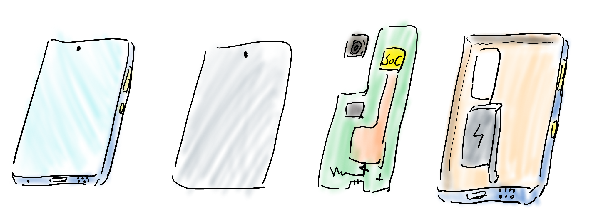
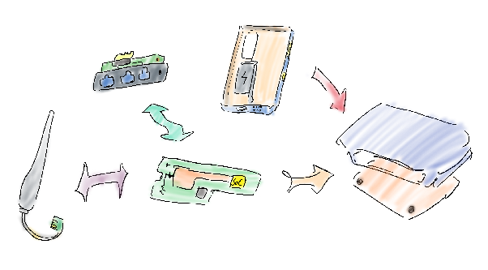

# Phone Router Repurposing Design

- **Unit**: MGMT3000 — Engineering Management and Professional Practice
- **Study Period**: 2024 Trimester 1A
- **Degree Programme**: Bachelor of Information Technology — Awarded with Distinction by Curtin University
- **Overall Unit Mark**: 79 (Distinction)

<table>
  <thead>
    <tr>
      <th colspan="6">Curtin University &bull; Bachelor of Information Technology</th>
    </tr>
  </thead>
  <tbody>
    <tr align="center" style="font-weight: bold; background-color: #f6f8fa;">
      <td>2022 T3A</td>
      <td>2023 T1A</td>
      <td>2023 T2A</td>
      <td>2023 T3A</td>
      <td>2024 T1A</td>
      <td>2024 T2A</td>
    </tr>
    <tr>
      <td valign="top">
        <abbr title="Fundamentals of Programming (92 HD)"><b>COMP1005</b></abbr> 
        &bull; <a href="https://github.com/honneground/COMP1005-Vampire-Ecosystem-Simulation">Vampire Eco</a>         &bull; <a href="https://github.com/honneground/COMP1005-Vehicle-Emissions-Analyzer">Emissions</a>       </td>
      <td valign="top">
        <abbr title="Data Structures and Algorithms (89 HD)"><b>COMP1002</b></abbr> 
        &bull; <a href="https://github.com/honneground/COMP1002-StudyHelp-Academic-Network">StudyHelp</a>         &bull; <a href="https://github.com/honneground/COMP1002-Advanced-Data-Structures-and-Visualizer">Visualizer</a>         <abbr title="Unix and C Programming (90 HD)"><b>COMP1000</b></abbr> 
        &bull; <a href="https://github.com/honneground/COMP1000-Terminal-Maze-Survival-Game">Maze Survival</a>         &bull; <a href="https://github.com/honneground/COMP1000-Terminal-Maze-Darkness-Game">Maze Darkness</a>         &bull; <a href="https://github.com/honneground/COMP1000-Bookstore-Transaction-Simulator">Bookstore</a>         <abbr title="Introduction to Software Engineering (95 HD)"><b>ISAD1000</b></abbr> 
        &bull; <a href="https://github.com/honneground/ISAD1000-Software-Testing-and-Pocket-Beast-Game">Pocket Beast</a>       </td>
      <td valign="top">
        <abbr title="Unix Systems Programming (88 HD)"><b>COMP2002</b></abbr> 
        &bull; <a href="https://github.com/honneground/COMP2002-Parallel-Directory-File-Calculator">Dir Calculator</a>         <abbr title="Operating Systems (80 HD)"><b>COMP2006</b></abbr> 
        &bull; <a href="https://github.com/honneground/COMP2006-Customer-Queue-Concurrency-Simulation">Queue Sim</a>       </td>
      <td valign="top">
        <abbr title="Database Systems (80 HD)"><b>ISYS2014</b></abbr> 
        &bull; <a href="https://github.com/honneground/ISYS2014-Relational-Database-Management-System">FootyStats DB</a>         <abbr title="Quantitative Techniques for Business (87 HD)"><b>ECOM2001</b></abbr> 
        &bull; <a href="https://github.com/honneground/ECOM2001-Econometric-Statistical-Analysis-R">Econometric R</a>       </td>
      <td valign="top" style="background-color: #f1f8ff; border: 2px solid #0969da;">
        <abbr title="Financial Decision Making (93 HD)"><b>ACCT1002</b></abbr> 
        &bull; <a href="https://github.com/honneground/ACCT1002-Financial-Decision-Calculators">Finance Tools</a>         <abbr title="Human Computer Interface (71 D)"><b>ICTE3002</b></abbr> 
        &bull; <a href="https://github.com/honneground/ICTE3002-Lumen-Interaction-Design">Lumen UI</a>         <abbr title="Engineering Management and Professional Practice (79 D)"><b>MGMT3000</b></abbr> 
        &bull; <b>&#128073; Phone Router</b>       </td>
      <td valign="top">
        <abbr title="Capstone Computing Project 1 (94 HD)"><b>ISAD3000</b></abbr> 
        &bull; <a href="https://github.com/honneground/ISAD3000-CurtinSG-App-Design">CurtinSG UI</a>         <abbr title="Capstone Computing Project 2 (95 HD)"><b>ISAD3001</b></abbr> 
        &bull; <a href="https://github.com/honneground/ISAD3001-CurtinSG-Student-App">CurtinSG App</a>         <abbr title="Advanced Computer Communications (88 HD)"><b>CNCO3002</b></abbr> 
        &bull; <a href="https://github.com/honneground/CNCO3002-Multi-Service-Socket-Server">Socket Server</a>       </td>
    </tr>
  </tbody>
</table>

## Assignment context and constraints

This individual assignment proposed a sustainable engineering initiative and developed a project charter and execution plan. The work covered a waste-material source, a proposed product, environmental/social benefits, commercial rationale, scope, risks, work breakdown, dependencies, schedule, resources and budget.

The proposal repurposes obsolete Android phones into affordable Wi-Fi routers. Its device-selection and B2B distribution strategy aims to reuse suitable components while addressing electronic waste and access to connectivity. The submitted outcome is the proposal and management/design package.

## Deliverables

- [Personal project proposal](docs/proposal.md)
- [Project charter and detailed plan](docs/project-charter.md)
- Hand-drawn component and assembly illustrations
- Work breakdown, dependency/critical-path network, Gantt chart and resource/budget tables
- Editable draw.io design sources in `design/`

## Planning results

The charter sets out a 500-unit pilot, a staged research/design/procurement/production/handover plan, resource estimates and an estimated total project budget of $204,871.71.

---

## Portfolio note

This Git repository was created retrospectively from the original project code, with assistance from OpenAI Codex and Antigravity in curating the repository and writing this README for publication. The initial commit timestamp is backdated to the original coursework submission date, followed by the final release commit.

