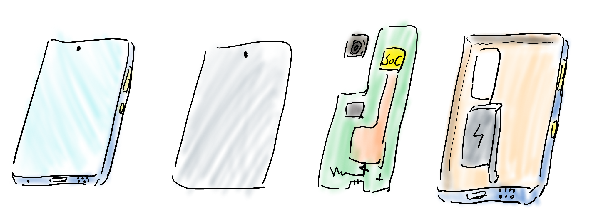
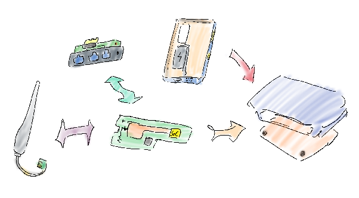
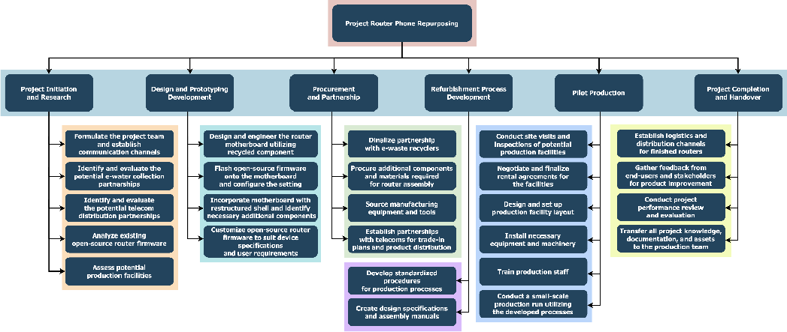
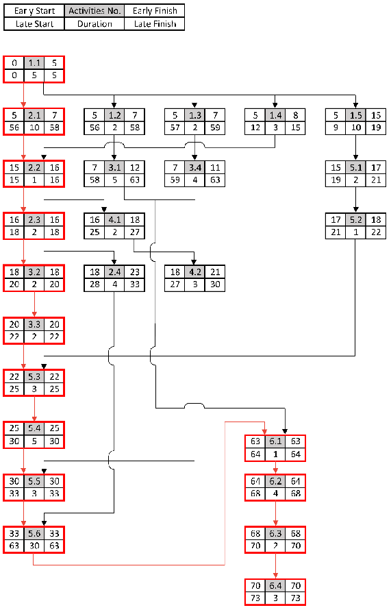
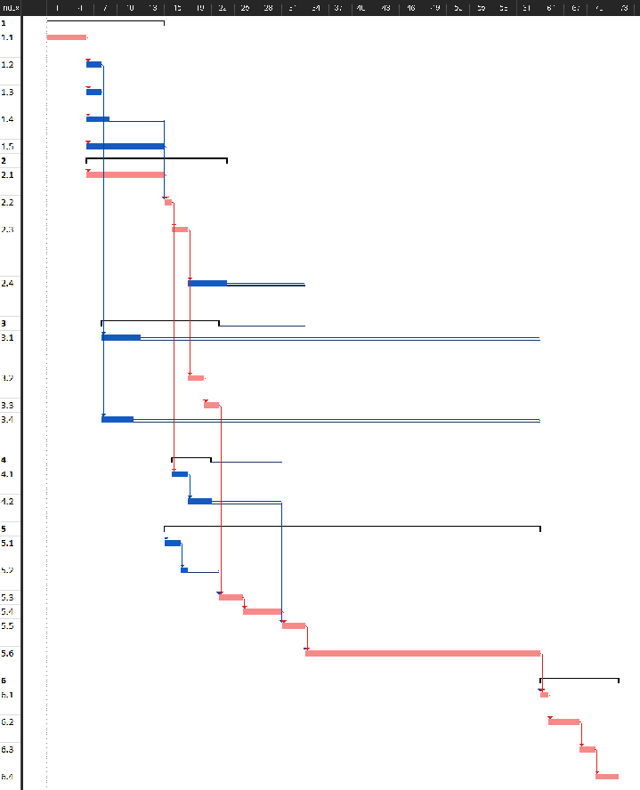

# Phone Router Repurposing Project Charter

# 1\. Project Registration

## 1.1 Project name / Tile

Project Router Phone Repurposing 

## 1.2 Project \#

EMPP-2024S1-01 

## 1.3 Creation Date

13 April, 2024

## 1.6 Brief Project Description

Converting disused Android smartphones into Wi-Fi routers to provide affordable network solutions while reducing electronic waste

## 1.7 Recommendation

As the project manager, I recommend that the project be authorised for execution. It bridges the digital divide in underserved communities while providing a sustainable solution for electronic waste management. The project offers an affordable alternative to conservative routers by creatively reusing existing hardware and open-source software. To manufacture the product on a large scale, I advocate committing dedicated resources to acquiring disused devices, developing standardised refurbishing procedures, and collaborating with telecommunications companies for distribution channels. This project has the potential to have a beneficial environmental and social impact if it is properly planned and resourced.

For the pilot production run, I recommend producing 500 routers in the first month. This quantity will allow for enough testing, feedback, and process improvement without resulting in an excessive amount of inventory. If changes are necessary, a trial run of 500 units provides sufficient flexibility for the project.

# 2\. Project Scope

## 2.1 Project Goal and Objectives

| Project Goal | Project Objectives |
| :---- | :---- |
| Develop a sustainable and cost-effective solution to address the digital divide through converting disused smartphones into affordable Wi-Fi routers. | Build a robust supply of recycled e-waste source and other materials. |
|  | Customize and integrate open-source router firmware (e.g., OpenWRT) effectively. |
|  | Develop a standardized refurbishment process for selected smartphone models. |
|  | Establish a distribution and support network for the repurposed routers. |

## 2.2 Deliverables, Outcome, and Key Benefits

| Deliverables | Outcome | Key Benefits |
| :---- | :---- | :---- |
| Functional Wi-Fi router product | Affordable internet connectivity for underserved areas | Promotes digital inclusion and reduces the digital divide |
| Customized Firmware | Tailored router functionality and optimized performance | Reduce the research and development cost, limit the potential risk |
| Standardized Refurbishment & Configuration Process | Scalable model for router production. | Enables expansion of the project, job creation in refurbishing sector. |
| Technical and Project Documentation | Knowledge transfer, future improvements. | Improves project scalability and future efficiency |
| E-Waste Recycling Partnerships | Secure and sustainable source of disused smartphones. | Reduces hazardous e-waste, supports e-waste recyclers. |
| Distribution channel partnerships | Sustainable outreach to target markets through telecom providers | Ensures the product reaches its intended users effectively |

## 2.3 Exclusions

| Non-Android Devices | Focus remains on lower-cost, obsolete smartphones for affordability. High-end devices are excluded as they have better resale value in the used market. |
| :---- | :---- |
| High-End Repurposing | Focus remains on lower-cost, obsolete smartphones for affordability. High-end devices are excluded as they have better resale value in the used market. |
| In-House Operating System | The project will utilize and customize existing open-source firmware instead of developing a proprietary router operating system. |
| Direct End-User Sales | Initial focus will be on B2B (business-to-business) distribution models through telecom providers, limiting direct interaction with end-consumers. |

## 2.4 Key Risks

| Key Risks | Mitigation Strategy |
| :---- | :---- |
| Limited availability of suitable disused smartphones | Establish multiple sourcing channels (recyclers, donation programs, trade-in partnerships) |
| Technical challenges in repurposing and integrating components | Robust R\&D phase, collaboration with open-source communities |
| Compatibility issues with open-source firmware | Focus on highly compatible chipsets (e.g., Snapdragon), in-house software development expertise |
| Cost overruns due to component price fluctuations | Bulk procurement for economies of scale |
| Difficulty establishing partnerships or distribution channels | Proactive outreach to potential partners, emphasize the project's social and environmental benefits |
| Limited interest from telecommunication providers | Demonstrate the project's social impact and cost-effectiveness for bundled service offerings. |

## 2.5 Project Illustration

### 2.5.1 Disassemble

The stylus-drawn diagram of the main components of a smartphone, which serve as the source waste material of the initiative. The diagram illustrates the following components: the display, the motherboard with CMOS, and the enclosure with the battery.

### 2.5.2 Reassemble

 The stylus-drawn diagram of how the recycled components are restructured and integrated with the procured parts to assemble the router.

# 3\. Project Plan

## 3.1 Functional Diagram

## 3.2 Indicative Schedule

### 3.2.1 Work Breakdown Structure Table

#### 3.2.1.1 High-level work breakdown structure

---

1.0 Project Initiation and Research

* 1.1 Formulate the project team and establish communication channels  
* 1.2 Identify and evaluate the potential e-water collection partnerships   
* 1.3 Identify and evaluate the potential telecom distribution partnerships   
* 1.4 Analyze existing open-source router firmware  
* 1.5 Assess potential production facilities  
    
    
    
  2.0 Design and Prototyping Development  
* 3.1 Design and engineer the router motherboard utilizing recycled component  
* 3.3 Flash open-source firmware onto the motherboard and configure the setting  
* 3.2 Incorporating the motherboard with the restructured shell and identifying any necessary additional components for the router  
* 3.4 Customize open-source router firmware to suit device specifications and user requirements  
  3.0 Procurement and Partnership  
* 3.1 Negotiate and finalize partnership agreements for sourcing disused smartphones from e-waste recyclers  
* 3.2 Procure additional components and materials required for router assembly  
* 3.3 Source manufacturing equipment and tools  
* 3.4 Establish partnerships with telecommunications providers for trade-in plans and product distribution  
  4.0 Refurbishment Process Development  
* 4.1 Develop standardized procedures for production processes  
* 4.2 Create design specifications and assembly manuals  
  5.0 Pilot Production   
* 5.2 Conduct site visits and inspections of potential production facilities  
* 5.3 Negotiate and finalize rental agreements for the facilities  
* 5.4 Design and set up production facility layout  
* 5.4 Install necessary equipment and machinery  
* 5.5 Train production staff in accordance with the design specifications and assembly manuals  
* 5.6 Conduct a small-scale production run utilizing the developed processes  
  6.0 Project Completion and Handover  
* 6.1 Establish logistics and distribution channels for finished routers  
* 6.2 Gather feedback from end-users and stakeholders for product improvement  
* 6.4 Conduct project performance review and evaluation  
* 6.6 Transfer all project knowledge, documentation, and assets to the production team

---

#### 3.2.1.2 Dependencies/Predecessors and Cost Estimating

| Index | Task Name | Duration | Predecessors | Successors |
| :---- | :---- | :---- | :---- | :---- |
| **1** | **Project Initiation and Research** | **15 days** |  |  |
| 1.1 | Formulate the project team and establish communication channels | 5 days |  | 1.1, 1.2, 1.3, 1.4, 1.5, 2.1 |
| 1.2 | Identify and evaluate the potential e-water collection partnerships | 2 days | 1.1 | 3.1 |
| 1.3 | Identify and evaluate the potential telecom distribution partnerships | 2 days | 1.1 | 3.4 |
| 1.4 | Analyze existing open-source router firmware | 3 days | 1.1 | 2.2 |
| 1.5 | Assess potential production facilities | 10 days | 1.1 | 5.1 |
| **2** | **Design and Prototyping Development** | **18 days** |  |  |
| 2.1 | Design and engineer the router motherboard utilizing recycled component | 10 days | 1.1 | 2.2 |
| 2.2 | Flash open-source firmware onto the motherboard and configure the setting | 1 day | 1.4, 2.1 | 2.3, 4.1 |
| 2.3 | Incorporate the motherboard with the restructured shell and identify any necessary additional components for the router | 2 days | 2.2 | 2.4, 3.2 |
| 2.4 | Customize open-source router firmware to suit device specifications and user requirements | 5 days | 2.3 | 5.6 |
| **3** | **Procurement and Partnership** | **15 days** |  |  |
| 3.1 | Negotiate and finalize partnership agreements for sourcing disused smartphones from e-waste recyclers | 5 days | 1.2 | 6.1 |
| 3.2 | Procure additional components and materials required for router assembly | 2 days | 2.3 | 3.3 |
| 3.3 | Source manufacturing equipment and tools | 2 days | 3.2 | 5.3 |
| 3.4 | Establish partnerships with telecommunications providers for trade-in plans and product distribution | 4 days | 1.3 | 6.1 |
| **4** | **Refurbishment Process Development** | **5 days** |  |  |
| 4.1 | Develop standardized procedures for production processes | 2 days | 2.2 | 4.2 |
| 4.2 | Create design specifications and assembly manuals | 3 days | 4.1 | 5.5 |
| **5** | **Pilot Production** | **48 days** |  |  |
| 5.1 | Conduct site visits and inspections of potential production facilities | 2 days | 1.5 | 5.2 |
| 5.2 | Negotiate and finalize rental agreements for the facilities | 1 day | 5.1 | 5.3 |
| 5.3 | Design and set up production facility layout | 3 days | 3.3, 5.2 | 5.4 |
| 5.4 | Install necessary equipment and machinery | 5 days | 5.3 | 5.5 |
| 5.5 | Train production staff in accordance with the design specifications and assembly manuals | 3 days | 4.2, 5.3 | 5.6 |
| 5.6 | Conduct a small-scale production run utilizing the developed processes | 30 days | 2.4, 5.5 | 6.1 |
| **6** | **Project Completion and Handover** | **10 days** |  |  |
| 6.1 | Establish logistics and distribution channels for finished routers | 1 day | 3.1, 3.4, 5.6 | 6.2 |
| 6.2 | Gather feedback from end-users and stakeholders for product improvement | 4 days | 6.1 | 6.3 |
| 6.3 | Conduct project performance review and evaluation | 2 days | 6.2 | 6.4 |
| 6.4 | Transfer all project knowledge, documentation, and assets to the production team | 3 days | 6.3 |  |

####  3.2.1.3 WBS Tree

#### 3.2.1.4 Milestones

##### 3.2.1.4.1 Network Diagram (Critical Path Identifying)

##### 3.2.1.4.2 Slack (Float) Table

| Index | Task Name | Duration | Critical | Early Start | Early Finish | Late Start | Late Finish | Slack |
| :---- | ----- | :---: | :---: | :---: | :---: | :---: | :---: | :---: |
| **1** | **Project Initiation and Research** |  |  |  |  |  |  |  |
| 1.1 | Formulate the project team and establish communication channels | 5 days | Yes | 0 | 5 | 0 | 5 | 0 |
| 1.2 | Identify and evaluate the potential e-water collection partnerships | 2 days | No | 5 | 7 | 56 | 58 | 51 |
| 1.3 | Identify and evaluate the potential telecom distribution partnerships | 2 days | No | 5 | 7 | 57 | 59 | 52 |
| 1.4 | Analyze existing open-source router firmware | 3 days | No | 5 | 8 | 12 | 15 | 7 |
| 1.5 | Assess potential production facilities | 10 days | No | 5 | 15 | 9 | 19 | 4 |
| **2** | **Design and Prototyping Development** |  |  |  |  |  |  |  |
| 2.1 | Design and engineer the router motherboard utilizing recycled component | 10 days | Yes | 5 | 15 | 5 | 15 | 0 |
| 2.2 | Flash open-source firmware onto the motherboard and configure the setting | 1 day | Yes | 15 | 16 | 15 | 16 | 0 |
| 2.3 | Incorporate the motherboard with the restructured shell and identify any necessary additional components for the router | 2 days | Yes | 16 | 18 | 16 | 18 | 0 |
| 2.4 | Customize open-source router firmware to suit device specifications and user requirements | 5 days | No | 18 | 23 | 28 | 33 | 10 |
| **3** | **Procurement and Partnership** |  |  |  |  |  |  |  |
| 3.1 | Negotiate and finalize partnership agreements for sourcing disused smartphones from e-waste recyclers | 5 days | No | 7 | 12 | 58 | 63 | 51 |
| 3.2 | Procure additional components and materials required for router assembly | 2 days | Yes | 18 | 20 | 18 | 20 | 0 |
| 3.3 | Source manufacturing equipment and tools | 2 days | Yes | 20 | 22 | 20 | 22 | 0 |
| 3.4 | Establish partnerships with telecommunications providers for trade-in plans and product distribution | 4 days | No | 7 | 11 | 59 | 63 | 52 |
| **4** | **Refurbishment Process Development** |  |  |  |  |  |  |  |
| 4.1 | Develop standardized procedures for production processes | 2 days | No | 16 | 18 | 25 | 27 | 9 |
| 4.2 | Create design specifications and assembly manuals | 3 days | No | 18 | 21 | 27 | 30 | 9 |
| **5** | **Pilot Production** |  |  |  |  |  |  |  |
| 5.1 | Conduct site visits and inspections of potential production facilities | 2 days | No | 15 | 17 | 19 | 21 | 4 |
| 5.2 | Negotiate and finalize rental agreements for the facilities | 1 day | No | 17 | 18 | 21 | 22 | 4 |
| 5.3 | Design and set up production facility layout | 3 days | Yes | 22 | 25 | 22 | 25 | 0 |
| 5.4 | Install necessary equipment and machinery | 5 days | Yes | 25 | 30 | 25 | 30 | 0 |
| 5.5 | Train production staff in accordance with the design specifications and assembly manuals | 3 days | Yes | 30 | 33 | 30 | 33 | 0 |
| 5.6 | Conduct a small-scale production run utilising the developed processes | 30 days | Yes | 33 | 63 | 33 | 63 | 0 |
| **6** | **Project Completion and Handover** |  |  |  |  |  |  |  |
| 6.1 | Establish logistics and distribution channels for finished routers | 1 day | Yes | 63 | 64 | 63 | 64 | 0 |
| 6.2 | Gather feedback from end-users and stakeholders for product improvement | 4 days | Yes | 64 | 68 | 64 | 68 | 0 |
| 6.3 | Conduct project performance review and evaluation | 2 days | Yes | 68 | 70 | 68 | 70 | 0 |
| 6.4 | Transfer all project knowledge, documentation, and assets to the production team | 3 days | Yes | 70 | 73 | 70 | 73 | 0 |

### 3.2.2 Gantt Chart

**

**

## 3.3 Indicative Budget Develop

### 3.3.1 Resource Lists

| Task Phrase | Resource Name | Supplier | Type | Qty | Price per Unit | Row Total | Phrase Total |
| :---- | ----- | :---- | :---- | ----- | ----- | ----- | ----- |
| Project Initiation and Research | Office (per week) | Landlord | fixed | 10.5 | \$257.69 | \$2,705.75 | \$2,705.75 |
| Design and Prototyping Development | Refurbished Android Phones | Disused Android Phones | variable | 5 | \$20.00 | \$100.00 | \$520.00 |
|  | Electronic Prototyping Kit | Electronics Supplier | variable | 2 | \$80.00 | \$160.00 |  |
|  | Breadboard | JB-Hi Fi | variable | 1 | \$10.00 | \$10.00 |  |
|  | Wires | JB-Hi Fi | variable | 50 | \$5.00 | \$250.00 |  |
|  | 3D printer | Online/Specialty retailer | fixed | 1 | \$500.00 | \$500.00 |  |
|  | CAD Software | Software vendor | fixed | 2 | \$300.00 | \$600.00 |  |
|  | Soldering Equipment | Bunnings Warehouse | fixed | 1 | \$150.00 | \$150.00 |  |
| Procurement and Partnership | Travel expenses (meetings) | Various | fixed | N/A | N/A | \$1,000.00 | \$1,500.00 |
|  | Legal Consultation (per hour) | Law Firm | fixed | 2 | \$250.00 | \$500.00 |  |
| Refurbishment Process Development | Document Printing | Local Print Shop | fixed | N/A | N/A | \$50.00 | \$50.00 |
| Pilot Production | Disused Android Phones | Telecoms | variable | 100 | \$15.00 | \$1,500.00 |  |
|  | Disused Android Phones | E-waste Recycler/Donation | variable | 400 | \$20.00 | \$8,000.00 |  |
|  | Plastic Shell | Alibaba | variable | 500 | \$0.38 | \$190.00 |  |
|  | External Antennas | Alibaba | variable | 100 | \$7.00 | \$700.00 | \$19,660.09 |
|  | Breadboard | Alibaba | variable | 500 | \$10.00 | \$5,000.00 |  |
|  | Wires | Alibaba | variable | 100 | \$2.00 | \$200.00 |  |
|  | Packaging Materials | Wholesale Supplier | variable | 500 | \$0.50 | \$250.00 |  |
|  | Production Facility (Studio) Rental (Monthly) | Real Estate | fixed | 1 | \$257.69 | \$257.69 |  |
|  | Assembly Workbenches | IKEA | fixed | 5 | \$200.00 | \$1,000.00 |  |
|  | Repair Toolkit | Bunnings Warehouse | fixed | 5 | \$500.00 | \$2,500.00 |  |
|  | Goggle | officeworks | fixed | 10 | \$4.39 | \$43.90 |  |
|  | Gloves | officeworks | fixed | 10 | \$1.85 | \$18.50 |  |
| Project Completion and Handover | N/A |  |  |  |  |  | N/A |

### 3.3.2 Human Resource Requirements

| Index | Task Name | Elapsed Effort (days) | Dependencies | HR Budget Internal |  |  |  |  | Equipment, Materials, Rental and Consumables |
| ----- | ----- | :---: | ----- | ----- | ----- | ----- | ----- | ----- | ----- |
|  |  |  |  | Labour Occupation | Hourly Rate | Numbers of Workers | Hour per Day | Total HR Buget Internal |  |
| **1** | **Project Initiation and Research** | **15** |  |  |  |  |  |  | \$2,705.75 |
| 1.1 | Formulate the project team and establish communication channels | 5 |  | Project Manager | \$75.00 | 1 | 8 | \$3,000.00 |  |
| 1.2 | Identify and evaluate the potential e-water collection partnerships | 2 | 1.1 | Business Development Specialist | \$50.00 | 2 | 8 | \$1,600.00 |  |
| 1.3 | Identify and evaluate the potential telecom distribution partnerships | 2 | 1.1 | Business Development Specialist | \$50.00 | 4 | 8 | \$3,200.00 |  |
| 1.4 | Analyze existing open-source router firmware | 3 | 1.1 | Software Engineer | \$90.00 | 2 | 8 | \$4,320.00 |  |
| 1.5 | Assess potential production facilities | 10 | 1.1 | Operations Manager | \$65.00 | 1 | 8 | \$5,200.00 |  |
| **2** | **Design and Prototyping Development** | **18** |  |  |  |  |  |  | \$1,770.00 |
| 2.1 | Design and engineer the router motherboard utilizing recycled component | 10 | 1.1 | Electrical Engineer | \$85.00 | 5 | 8 | \$34,000.00 |  |
| 2.2 | Flash open-source firmware onto the motherboard and configure the setting | 1 | 1.4, 2.1 | IT Technician | \$45.00 | 1 | 8 | \$360.00 |  |
| 2.3 | Incorporating the motherboard with the restructured shell and identifying any necessary additional components for the router | 2 | 2.2 | Hardware Engineer | \$80.00 | 5 | 8 | \$6,400.00 |  |
| 2.4 | Customize open-source router firmware to suit device specifications and user requirements | 5 | 2.3 | Software Engineer | \$90.00 | 3 | 8 | \$10,800.00 |  |
| **3** | **Procurement and Partnership** | **15** |  |  |  |  |  |  | \$1,500.00 |
| 3.1 | Negotiate and finalize partnership agreements for sourcing disused smartphones from e-waste recyclers | 5 | 1.2 | Contract Negotiator | \$60.00 | 2 | 8 | \$4,800.00 |  |
| 3.2 | Procure additional components and materials required for router assembly | 2 | 2.3 | Procurement Specialist | \$45.00 | 2 | 8 | \$1,440.00 |  |
| 3.3 | Source manufacturing equipment and tools | 2 | 3.2 | Procurement Specialist | \$45.00 | 3 | 8 | \$2,160.00 |  |
| 3.4 | Establish partnerships with telecommunications providers for trade-in plans and product distribution | 4 | 1.3 | Business Development Specialist | \$50.00 | 4 | 8 | \$6,400.00 |  |
| **4** | **Refurbishment Process Development** | **5** |  |  |  |  |  |  | \$50.00 |
| 4.1 | Develop standardized procedures for production processes | 2 | 2.2 | Technical Writer | \$55.00 | 3 | 8 | \$2,640.00 |  |
| 4.2 | Create design specifications and assembly manuals | 3 | 4.1 | Technical Writer | \$55.00 | 2 | 8 | \$2,640.00 |  |
| **5** | **Pilot Production** | **48** |  |  |  |  |  |  | \$19,660.09 |
| 5.1 | Conduct site visits and inspections of potential production facilities | 2 | 1.5 | Operations Manager | \$65.00 | 2 | 8 | \$2,080.00 |  |
| 5.2 | Negotiate and finalize rental agreements for the facilities | 1 | 5.1 | Contract Negotiator | \$60.00 | 1 | 8 | \$480.00 |  |
| 5.3 | Design and set up production facility layout | 3 | 3.3, 5.2 | Production Manager | \$60.00 | 4 | 8 | \$5,760.00 |  |
| 5.4 | Install necessary equipment and machinery | 5 | 5.3 | Production Technician | \$35.00 | 4 | 8 | \$5,600.00 |  |
| 5.5 | Train production staff in accordance with the design specifications and assembly manuals | 3 | 4.2, 5.3 | Trainer | \$50.00 | 1 | 8 | \$1,200.00 |  |
| 5.6 | Conduct a small-scale production run utilizing the developed processes | 30 | 2.4, 5.5 | Production Manager | \$60.00 | 1 | 8 | \$14,400.00 |  |
| **6** | **Project Completion and Handover** | **10** |  |  |  |  |  |  | N/A |
| 6.1 | Establish logistics and distribution channels for finished routers | 1 | 3.1, 3.4, 5.6 | Supply Chain Manager | \$70 | 2 | 8 | \$1,120.00 |  |
| 6.2 | Gather feedback from end-users and stakeholders for product improvement | 4 | 6.1 | Market Research Analyst | \$20 | 8 | 8 | \$5,120.00 |  |
| 6.3 | Conduct project performance review and evaluation | 2 | 6.2 | Project Manager | \$75 | 1 | 8 | \$1,200.00 |  |
| 6.4 | Transfer all project knowledge, documentation, and assets to the production team | 3 | 6.3 | Operations Manager | \$75 | 2 | 8 | \$3,600.00 |  |

### 3.3.3 Project Budget Summary

|  | Total HR Buget Internal | Equipment, Materials, Rental and Consumables |
| :---- | ----- | ----- |
| Column Totals | \$129,520.00 | \$25,685.84 |
| Total Direct Cost | \$155,205.84 |  |
| \+ Total Indirect Cost | \$31,041.17 |  |
| Total Project Cost | \$186,247.01 |  |
| \+ Total Contingency Cost | \$18,624.70 |  |
| Project Budget | \$204,871.71 |  |
