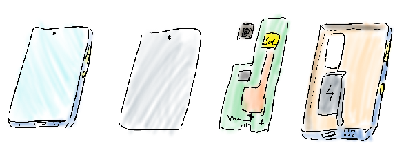
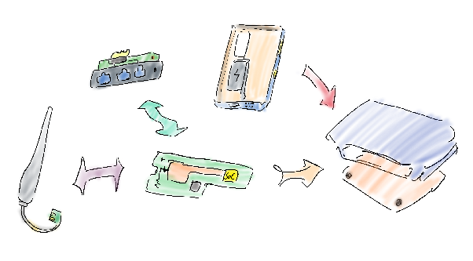

# Phone Router Repurposing Proposal

### Rationale

The average turnover of consumer electronics was significantly accelerated by rapid technological advancement. Thereby, the electronic waste issue is exacerbated by those obsoleted disused devices. Improper disposal of e-waste can unleash hazardous materials like lead, mercury, and cadmium into the environment. The conventional approach of e-waste recycling involves dismantling complete components into raw materials, increasing the risk of exposure to toxic substances. Both the workers within the recycling facility and the neighbouring community are at risk of suffering health problems, including cancer. So, a sustainable engineering initiative is proposed to repurpose old phones into routers in response to the issue. 

### Product

The project aims to develop a low-cost Wi-Fi router using components from recycled disused smartphones. The key "waste" material needed for the project is disused smartphones that would otherwise be discarded. The optimal source of waste materials is the low-ended, obsolete Android smartphone. The integral components providing computational capabilities and internet connectivity are the motherboard and the embedded system-on-chip (SOC). Besides, other smartphone components will be repurposed to construct various router components. While not necessary for the basic version, as the embedded IC is sufficient, external antennas may be procured from the market to enhance wireless performance.

Open-source router firmware like OpenWRT could be customised, utilised, and integrated with functional recyclable components to provide affordable wireless internet connectivity to underdeveloped regions and disadvantaged populations. Consequently, full control and complete modifiability of the device are indispensable. Devices with Apple and other chips are excluded due to their lack of modifiability. Additionally, high-end devices can be easily refurbished and sold on the used market, making repurposing unnecessary. Due to its large market share, only the Snapdragon chip is included to guarantee scalability. Sourcing devices featuring Snapdragon 400 and 600 series chips is prioritised, owing to their potential for generating a lucrative recycling price.

Figure 1: The stylus-drawn diagram of the main components of a smartphone, which serve as the source waste material of the initiative. The diagram illustrates the following components: the display, the motherboard with CMOS, and the enclosure with the battery.

### Benefits

Environmentally, this initiative diverts disused smartphones from landfills and mitigates hazardous electronic waste pollution. Recycling smartphones could remove these devices from the dump to reduce harmful e-waste. Instead, the lifespan of existing devices would be extended to release the negative impact of the rapid turnover of consumer electronics, enhancing sustainability. As the project's deliverable, affordable routers could bridge the digital divide in disadvantaged communities, contributing to a great social interest. Furthermore, recycling e-waste as complete components instead of breaking it down into raw materials lessens potential exposure to toxins, positively impacting the health and well-being of workers in the industry and improving overall workplace safety.  

Figure 2: The stylus-drawn diagram of how the recycled components are restructured and integrated with the procured parts to assemble the router.

### Process

1. Collection: Source old smartphones through partnering with e-waste recyclers and donation programs  
2. Assessment: Evaluating devices for repairability and compatibility with router firmware. (e.g., if the device's bootloader is not unlockable, only the chips and memories will be recycled)  
3. Refurbishment: Replacing damaged components and adding complementary components as needed.  
4. Configuration: Flashing customised open-source router firmware (e.g., OpenWRT) to repurpose the devices.  
5. Assembling: Incorporating the motherboard with the restructured shell, testing the functionality, and packaging the devices into the containers.  
6. Deployment: Providing routers to targeted communities through partner retailers and telecom providers 

 

### Innovation

Compared to purpose-built routers, the cost could be drastically reduced by leveraging existing hardware with open-source firmware. This process can be scaled through implementing standardised refurbishment procedures, ensuring the potential for expansion.

### Commercial Rationale

The potential collaborators for this project are telecommunications providers. They could deliver cost-effective bundled service offers that include our product. Besides, disused phones as source material could be collected from them as trade-in options. Given that the target market comprises underprivileged communities, small businesses, and developing regions, which are characterised by limited purchasing power, it is less likely that local retailers will distribute this product at a limited profit. Consequently, the commercial positioning of this project is focused on business-to-business transactions.

#### Conclusion 

Since COVID-19, the surge in demand for ICT devices for work-from-home and remote lectures and the Global Supply Chain Crisis have put the chips and the end product to scarcity and high prices. The inventiveness in the initiative of sustainable engineering solutions eases the negative impact of the crisis while minimising the negative environmental effects of e-waste. The lifespan of electronic devices could be extended, minimising the waste generated and, thereby, the environmental impact. More affordable products would become viable through repossessing components from obsolete devices. Notably, the project not only addresses the affordability issue but also generates job opportunities and closes the digital gap. Ultimately, the goal is to foster community development and create a more sustainable and equitable society.
